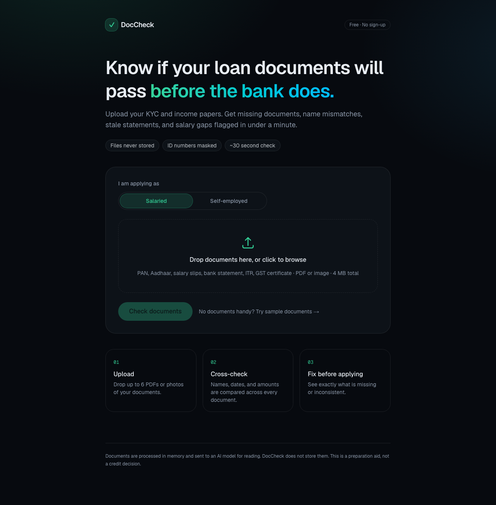
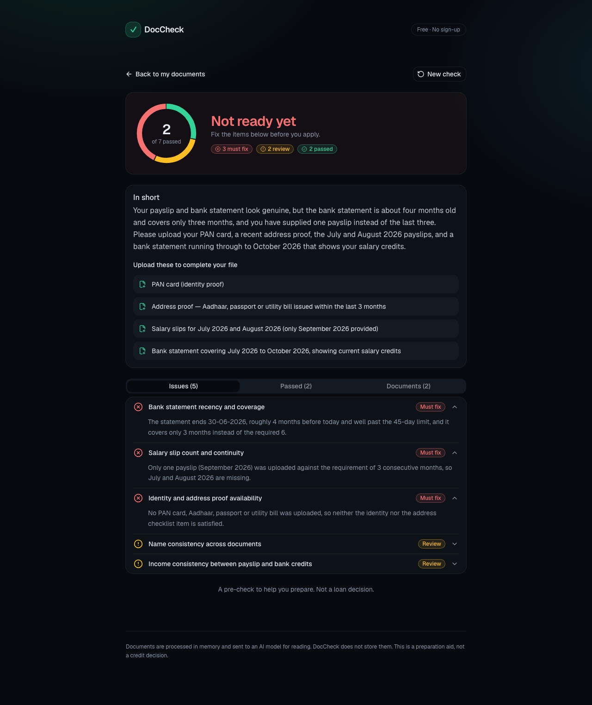
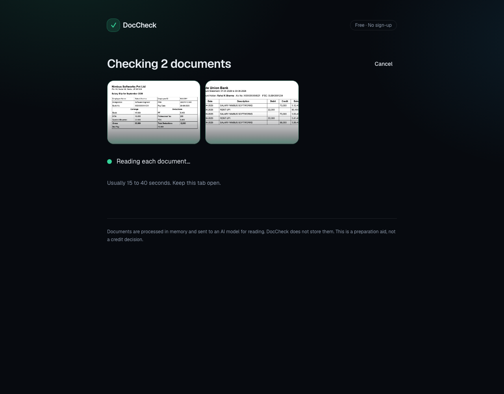
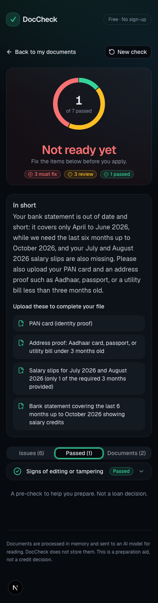

# DocCheck

**AI pre-disbursal document verification for loan applications.**
Upload KYC and income documents. DocCheck extracts the key fields, masks identity numbers, and flags missing documents, name mismatches, stale statements, and salary-to-bank-credit gaps, in about 15 seconds.

**Live:** https://doccheck.cachetray-vinay.workers.dev · click "Try sample documents" to run a check without uploading anything.

<p align="center">
  
  
</p>

## What it checks

| Check | Rule |
|---|---|
| Name consistency | Same person across all documents; minor initial differences are a warning |
| Bank statement | Must end within 45 days and cover 6 months |
| Salary slips | Latest within 2 months; 3 consecutive months expected |
| Income consistency | Bank salary credits vs payslip net pay: >10% gap in any month warns, >25% average gap fails |
| Address proof | Utility bill no older than 3 months |
| Tampering | Totals that don't add up, mismatched fonts, altered figures |
| Checklist | Missing documents for salaried or self-employed applicants |

The thresholds are written into the prompt as fixed rules rather than left to the model's judgement, so the same documents get the same verdict on every run.

<p align="center">
  
  
</p>

## How it works

```
Browser (Next.js, shadcn/ui, react-spring)
  └─ POST /api/check  (Route Handler on Cloudflare Workers)
       ├─ checks file type from the actual bytes, ≤6 files, ≤4 MB, rate limit
       ├─ PDFs → text via unpdf when the model can't read PDFs
       └─ LLM via Vercel AI SDK → schema-validated JSON report (zod)
```

- **Provider-agnostic:** one environment variable switches the model: `anthropic:…`, `openai:…`, `deepseek:…`, or any OpenAI-compatible endpoint.
- **Privacy:** files are processed in memory and never stored; every identity number is masked to its last 4 characters.
- **Structured output:** the model must return a fixed report schema, so the UI and any downstream system always get the same shape.

## Run locally

```bash
npm install
cp .env.example .env.local   # set LLM_MODEL and the matching API key
npm run dev
```

Deploy to Cloudflare Workers: `npx opennextjs-cloudflare build && npx wrangler deploy`, then set the key with `npx wrangler secret put`.

## Stack

Next.js 16 · React · TypeScript · Tailwind CSS · shadcn/ui · react-spring · Vercel AI SDK · zod · unpdf · Cloudflare Workers (OpenNext)
